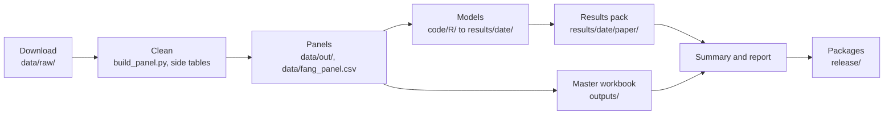

# Project structure

ECON 499R, Emory University. As of 2026-11-06. All paths are relative to the "AI impact on Renewables" folder. Nothing was run or changed to write this.

## 1. What the project is

Shunji Lewandowski (modeling) and Alexander Hendricks (data and finance), advised by Prof. Fohlin, ask whether growth in AI-related activity is associated with more or less electricity use, energy efficiency and renewable energy across U.S. states, 2015-2025. The main AI measure is private data-center jobs per 1,000 workers. The first test applies Zhang et al. (2026), "Blessing or Peril?": a direct association (H1), channels through tech jobs and economic density (H2) and spillovers between states (H3). The second replicates Fang, Lee and Li (2025), who find a positive association between AI job postings and renewable energy use. The Georgia piece is a case box: Georgia Power's large-load filings and a solar cost learning curve to 2035, which isn't a forecast of ours. The analysis and packaging finished on Nov 4. No association holds up: electricity use and efficiency show none, the renewable results fail timing or scaling checks, no H2 channel appears, H3 is not supported, and Fang's +0.053 becomes -0.019 (p = 0.317) on current data. Still open are team review (Nov 17), the Georgia Q1-Q4 2024 reports, the draft (Nov 24) and turn-in (Dec 1).

## 2. Folder map

`[git]` = tracked, `[ignored]` = kept out of git, `[mixed]` = some of each.

```text
AI impact on Renewables/
├── CLAUDE.md, EXPERIMENTS.md, .gitignore  [git]      Conventions; spec and divergence register
├── .env                                   [ignored]  Census key; never print or commit
├── _to_delete/                            [ignored]  Files waiting for a delete decision
├── archive/                               [ignored]  Saved Claude chat
│   └── Energy_Data_Collection_Methods_Claude_Chat_files/  [ignored]  The chat page's assets
├── code/                                  [git]      Analysis code
│   ├── python/                            [git]      Tables, workbook, report, packaging
│   └── R/                                 [git]      Model drivers and load_panel.R
├── data/                                  [mixed]    Documentation tracked; cleaned CSVs ignored
│   ├── bea/, bls/, census/, eia/, ferc/   [ignored]  Early copies of raw files, one folder each
│   ├── out/                               [ignored]  Master panel, W matrices, finance tables
│   ├── raw/                               [ignored]  Raw downloads by source; read-only
│   └── receipts/                          [git]      One provenance file per source
├── docs/                                  [git]      Handoffs and write-ups by date
│   └── 2026-11-01/, -02/, -03/, -04/, -06/  [git]    One folder per date (-06 holds this file, not yet committed)
├── econ499r_starter/                      [mixed]    Original starter kit; still runs the data build
│   ├── R/                                 [git]      First R port of Steps 1-3, never run
│   ├── reference/                         [mixed]    Check values tracked; memo and Zhang PDFs ignored
│   └── scripts/                           [git]      Download, panel and side-table scripts
├── literature/                            [ignored]  Paper PDFs
├── logs/                                  [git]      Build and check logs
│   └── 2026-11-01/, -02/, -03/, -04/      [git]      One folder per date
├── notebooks/                             [git]      Nine executed notebooks
├── notes/                                 [mixed]    Handoff and interview transcript tracked; memo PDF ignored
├── outputs/                               [ignored]  Workbook, results PDF and HTML (one stray lock file: §9)
│   ├── ECON499R_csv_for_R/                [ignored]  Oct 30 CSV copies, out of date
│   └── old/                               [ignored]  Three earlier workbooks
├── prompts/                               [git]      Instructions for each phase
│   └── _retired/                          [ignored]  Empty, so git doesn't record it
├── release/                               [ignored]  Packages built by script
│   ├── github/                            [ignored]  Clean copy with its own git repo, and its checklist
│   └── results_and_data_2026-11-04/       [ignored]  Local team package (a zip sits next to it)
└── results/                               [git]      Model output by run date
    └── 2026-11-02/, -03/, -04/            [git]      See section 6
```

## 3. Pipeline

Data scripts take positional arguments. Everything from models onward takes `--date YYYY-MM-DD`. Below, `$S` means `econ499r_starter/scripts`.



1. **Download.** `econ499r_starter/download_all.py` and `$S/download_*.py`. In: the web, plus `.env`. Out: `data/raw/<source>/`. Run: `cd data && python3 ../econ499r_starter/download_all.py --with-eia-forms && cd ..`
2. **Master panel.** `$S/build_panel.py`, `$S/ferc_fin.py`. In: `data/raw/`. Out: `data/out/state_panel_2015_2025.csv` (561 rows, 80 columns), W matrices, finance tables. Run: `python3 -I $S/build_panel.py data/raw data/out`
3. **Side tables.** `$S/build_side_tables_nov4.py`, `$S/build_ai_allown.py`, `$S/build_fang_tables.py`, `$S/build_net_producer_defs.py`. In: `data/raw/`, the panel. Out: `data/*.csv`, including `data/fang_panel.csv`. Run: `python3 -I $S/build_fang_tables.py data/raw data logs/2026-11-04`
4. **Validate.** `$S/validate_panel.py`. In: raw files, the panel. Out: `logs/2026-11-02/build/validation/`, written up in `data/DATA_VALIDATION.md`. Run: `python3 $S/validate_panel.py data/raw data/out/state_panel_2015_2025.csv logs/2026-11-02/build/validation`
5. **Models.** `code/R/04*.R`, plus `code/python/04f_georgia_solar.py`. All R models load data through `code/R/load_panel.R`, except the Fang drivers, which read `data/fang_panel.csv`. Out: `results/<date>/<block>/`. Run: `Rscript code/R/04b_step1_twfe.R --date 2026-11-02`
6. **Tables and findings.** `code/python/04e_spec_curve.py`, `04e3_stretch_tables.py`, `04h_fang_tables.py`, `04g_results_pack.py`. In: result CSVs. Out: `results/<date>/paper/`. No new models. Run: `python3 code/python/04g_results_pack.py --date 2026-11-04`
7. **Workbook.** The five commands in `data/receipts/master_workbook.md`. In: cleaned data, receipts, validation logs. Out: `outputs/ECON499R_Master_Data_<date>.xlsx`, `data/variable_registry.csv`, `data/DATA_DICTIONARY.md`. Run: `python3 code/python/build_master_workbook.py --date 2026-11-04`
8. **Summary and report.** `code/python/04j_project_summary.py`, `code/python/04k_results_report.py`. Out: `docs/<date>/project-summary.md`, `outputs/ECON499R_Results_<date>.pdf` and `.html`. Run: `python3 code/python/04k_results_report.py --date 2026-11-04`
9. **Packages.** `code/python/build_github_package.py`, `code/python/build_results_package.py`. Out: `release/`. Run: `python3 code/python/build_results_package.py --date 2026-11-04`

## 4. Phases

Prompts are in `prompts/`, notebooks in `notebooks/`, handoffs in `docs/`.

| Phase | Prompt | What it did | Main outputs | Notebook | Handoff | Status |
|---|---|---|---|---|---|---|
| 01 | None in the folder | Sorted the folder, set conventions, started git | Folder layout | None | None | Done, inferred from later files |
| 02 | `02_data_audit_cleaning_excel.md` | Audited, built and validated the data | `data/out/`, `data/DATA_AUDIT.md`, `data/DATA_VALIDATION.md` | `02_data_and_methods_walkthrough.ipynb` | `2026-11-01/phase-2a-data-audit.md`, `2026-11-01/phase-2-data-audit-and-cleaning.md`, `2026-11-02/phase-2c-data-validation.md` | Done |
| 04a | `04a_methods_spec.md` | Locked the spec; set up R | `EXPERIMENTS.md`, `code/R/load_panel.R` | `04a_methods_spec.ipynb` | `2026-11-02/phase-4a-methods-spec.md` | Done |
| 04b | `04b_step1_twfe.md` | H1 with state and year fixed effects | `results/2026-11-02/h1/` | `04b_step1_twfe.ipynb` | `2026-11-02/phase-4b-step1.md` | Done |
| 04c | `04c_step2_mediation.md` | H2 mediation | `results/2026-11-03/h2/` | `04c_step2_mediation.ipynb` | `2026-11-03/phase-4c-step2.md` | Done |
| 04d | `04d_step3_spatial.md` | H3 spatial models | `results/2026-11-03/h3/`, `results/2026-11-03/h3_mainspec/` | `04d_step3_spatial.ipynb` | `2026-11-03/phase-4d-step3.md` | Done |
| 04e | `04e_robustness_stretch.md` | Robustness, timing placebo, stretch goals | `results/2026-11-04/robustness/`, `results/2026-11-04/h3_placebo/`, `results/2026-11-04/stretch/` | `04e_robustness_stretch.ipynb` | `2026-11-04/phase-4e-robustness-stretch.md` | Done. Stretch was optional; Hansen threshold and data-center MW swap not run |
| 04f | `04f_georgia_solar_learning_curve.md` | Georgia solar cost arithmetic | `results/2026-11-04/georgia_solar/` | `04f_georgia_solar.ipynb` | `2026-11-04/phase-4f-georgia-solar.md` | Done (optional module) |
| 04g | `04g_results_pack.md` | Paper tables, figures, findings | `results/2026-11-04/paper/` | `04g_results_pack.ipynb` | `2026-11-04/phase-4g-results-pack.md` | Done |
| 04h | `04h_fang_test.md` | Fang replication and extension | `results/2026-11-04/fang/`, `data/fang_panel.csv` | `04h_fang_test.ipynb` | `2026-11-04/phase-4h-fang-test.md` | Done; extreme-weather split not run |
| 04i | `04i_master_workbook.md` | Master workbook | `outputs/ECON499R_Master_Data_2026-11-04.xlsx` | None | `2026-11-04/phase-4i-master-workbook.md` | Done |
| 04j | None (`06_finish.md` §7) | Project summary | `2026-11-04/project-summary.md` in `docs/` | None | `2026-11-04/finish-run-log.md` | Done |
| 04k | None (`06_finish.md` §9) | Results report | `outputs/ECON499R_Results_2026-11-04.pdf` | None | `2026-11-04/finish-run-log.md` | Done |
| 06 | `06_finish.md` | Finished the analysis; built both packages | `release/`, `2026-11-04/methods_section.tex` in `docs/` | None | `2026-11-04/finish-run-log.md`, `2026-11-04/fixes-before-push.md`, `2026-11-04/workbook-links-fix.md` | Done |

There's no phase 03 prompt. Phase 05 (GitHub) was replaced by `06_finish.md` §8. Optional sources not pulled: SEC refresh and Bloomberg.

## 5. Key files

| What | Where |
|---|---|
| Master panel | `data/out/state_panel_2015_2025.csv` |
| Fang panel | `data/fang_panel.csv` (561 rows, 41 columns) |
| Master workbook | `outputs/ECON499R_Master_Data_2026-11-04.xlsx` (start at README, then Variable Finder) |
| Results PDF | `outputs/ECON499R_Results_2026-11-04.pdf` |
| Findings | `results/2026-11-04/paper/findings.md` |
| Methods draft | `docs/2026-11-04/methods_section.tex` |
| Project summary | `docs/2026-11-04/project-summary.md` |
| Spec and divergence register | `EXPERIMENTS.md` (§0 is the register, §12 the tag rules) |
| Conventions and current state | `CLAUDE.md` |
| Source provenance | `data/receipts/`; start at `data/receipts/README.md` |
| Validation | `data/DATA_VALIDATION.md` |
| Variable registry and dictionary | `data/variable_registry.csv` (949 variables), which generates `data/DATA_DICTIONARY.md` |
| Clean GitHub copy | `release/github/econ499r-ai-renewables/`, with `release/github/CHECKLIST.md` |
| Team package | `release/results_and_data_2026-11-04/` and `release/results_and_data_2026-11-04.zip` |

## 6. Results layout

A date folder is the day a driver ran, not a full version of the project. Current results span all three.

| Folder | Holds |
|---|---|
| `results/2026-11-02/` | `h1/`, `tables/`, `figures/` |
| `results/2026-11-03/` | `h2/`, `h3/`, `h3_mainspec/` (the main SDM spatial model), `robustness/` (first run, replaced on Nov 4), `tables/`, `figures/` |
| `results/2026-11-04/` | `robustness/`, `h3_placebo/`, `stretch/`, `fang/` (with its own `tables/`), `georgia_solar/`, `paper/`, `figures/` |
| `results/2026-11-04/paper/` | `tables/` (CSV and LaTeX), `figures/`, `findings.md`, `TABLE_INDEX.csv`, `number_check.csv` and related checks |

Nov 4 has no top-level `tables/`; its tables are under `paper/` and `fang/`. Most folders hold a `RECEIPT.md` or `PROVENANCE.md`.

**Tags.** Each result row has a name built from its spec: `<block>_<model>_<ai-var>_<lag>_<controls>_<winsor>_<se>_<outcome>_<sample>`. For example, `h1_twfe_ai518210_lag1_ctrl4_w9901_cl-state_ln_ec_50s2015_2025` is H1, fixed effects, lagged AI, four controls, 1/99 winsorizing, SEs clustered by state, ln_ec, 50 states. A changed spec gets a new tag. `number_check.csv` traces the numbers in `findings.md` back to these tags.

**Status.** `ok` means the model ran and is usable. `FAILED` rows are kept on purpose: all 28 are in `results/2026-11-03/h3_mainspec/`, where the spatial parameter ρ fell outside its valid range. `NOT_RUN` records a planned row that couldn't or didn't run, with the reason in `note`. Only 25 of the 105 result CSVs have a status column (see §9).

## 7. Rebuild from scratch

I didn't run these. The order comes from the receipts, handoffs and scripts. **Use a fresh copy of the project:** the commands overwrite the dated folders, and the 04b scripts append, so rerunning them in place duplicates rows. Use these exact dates, because later scripts read `results/2026-11-02/` and `results/2026-11-03/` by name. A new download gets today's agency data, so the reproduction gates or the raw-file check may stop the run.

You need Python 3.13, R 4.6, LibreOffice and Chrome (Chrome is for the PDF). Put `CENSUS_KEY` in `.env`.

```bash
S=econ499r_starter/scripts
# 1. Download, after adding the browser files listed below
(cd data && python3 ../econ499r_starter/download_all.py --with-eia-forms)
python3 $S/download_nsf_tab10.py data/raw/nsf
python3 $S/download_fang_sources.py data/raw logs/2026-11-04/fang_downloads.csv
python3 $S/download_acs_broadband.py .env data/raw/acs data/acs_broadband.csv logs/2026-11-04/acs_spot_check.csv
python3 $S/download_noaa_degree_days.py data/raw/noaa data/noaa_degree_days.csv
# 2. Panel, side tables, checks (replace <scratch_dir> with any empty folder)
python3 -I $S/build_panel.py data/raw data/out
python3 -I $S/ferc_fin.py data/raw/pudl data/out
python3 $S/check_rps_vintages.py "data/raw/lbnl/RPS & CES Targets and Demand_June 2026.xlsx" <scratch_dir> logs/2026-11-04/rps_vintage_check.csv
python3 $S/build_side_tables_nov4.py data/raw data logs/2026-11-04/rps_vintage_check.csv data/out/state_panel_2015_2025.csv
python3 $S/build_ai_allown.py data/raw data/out/state_panel_2015_2025.csv data/ai_allown_518210.csv logs/2026-11-04/gov_518210_shares.csv
python3 -I $S/build_fang_tables.py data/raw data logs/2026-11-04
python3 $S/build_net_producer_defs.py data/raw/eia/seds data/fang_split_vars.csv data/fang_net_producer_definitions.csv
python3 $S/validate_panel.py data/raw data/out/state_panel_2015_2025.csv logs/2026-11-02/build/validation
python3 $S/build_file_inventory.py data/raw logs/2026-11-04/raw_sha256_manifest.csv data/FILE_INVENTORY.csv
# 3. Models
for f in 04b_step1_twfe 04b_step1_twfe_checks 04b_step1_twfe_ctrl4 04b_extras2; do Rscript code/R/$f.R --date 2026-11-02; done
for f in 04c_step2_mediation 04d_step3_spatial 04d2_sdm_mainspec; do Rscript code/R/$f.R --date 2026-11-03; done
D=2026-11-04
for f in 04e_robustness 04e2_spillover_placebo 04e3_stretch 04e4_weather_check 04h_fang_test 04h2_fang_net_producer; do Rscript code/R/$f.R --date $D; done
for f in 04e_spec_curve 04e3_stretch_tables 04h_fang_tables 04f_georgia_solar; do python3 code/python/$f.py --date $D; done
# 4. Workbook, results pack, summary, report, packages
for f in build_cross_source_checks build_raw_file_shapes build_georgia_tables build_master_workbook check_master_workbook 04g_results_pack 04j_project_summary 04k_results_report build_github_package build_results_package; do python3 code/python/$f.py --date $D; done
```

**Browser downloads:**
- LBNL RPS and solar files (`data/raw/lbnl/`)
- Epoch (`data/raw/epoch/`)
- OWID (`data/raw/owid/`)
- EPU (`data/raw/epu/`)
- RMI (`data/raw/rmi/`, from `data/data_download_all_pt1.zip`)
- Georgia PSC Q1 2026 attachment, Q2 2026 report and IRP appendices (`data/raw/georgia/`)
- **Still pending:** Georgia Q1-Q4 2024 large-load reports (Docket 55378)

Links are in `data/data_links.md`. Census population has no saved script, so its links are in `data/receipts/census_pop.md`.

## 8. Git

- **Branch:** `master`, 57 commits. It tracks `origin/main` and is 1 commit ahead (`a431b58`, the workbook links fix, isn't on GitHub).
- **Remote:** `https://github.com/SHLEW06/econ499r-ai-renewables.git`, private. `main` is at `ddc56e5` and holds this working repo's history, not the clean copy.
- **Excluded by `.gitignore`:** `.env`, `data/raw/`, `data/out/`, most cleaned CSVs in `data/`, the early copies in `data/`, all PDFs except figures in `results/`, `literature/`, `archive/`, `_to_delete/`, `release/`, and the workbooks and report in `outputs/`.
- **Clean copy:** `release/github/econ499r-ai-renewables/` is a separate repo with one commit (`089945b`) on `main`, 339 files, about 16.7 MB and no remote. It leaves out raw data, data that can't be redistributed, journal PDFs, notes, prompts and logs. Pushing it to the existing repo would need a force-push, which is your call (`release/github/CHECKLIST.md`).

## 9. Loose ends (nothing fixed)

**Need a decision**
- **The interview transcript is on GitHub.** `notes/Grijalva_interview_transcript_2026-10-28.txt` is tracked and on `main`, against rule 7 in `prompts/00_START_HERE.md`. The memo and Zhang PDFs are in past commits. Giving Alexander or a grader repo access, which the workbook's receipt links need, exposes all of it. `CLAUDE.md` §6 and that same rule read as if nothing has been pushed.
- `outputs/~$ECON499R_Master_Data_2026-11-04.xlsx` is an Excel lock file from Nov 4. It's the only reason `git status` shows `outputs/` as untracked, and `git add .` would commit it.
- `_to_delete/` still holds 10 files. Six are byte-identical to files in `data/raw/`, and two of the four zips are identical to each other.

**Stale or missing references**
- `prompts/_retired/` is empty, though `prompts/00_START_HERE.md` says retired prompts live there. `01_organize_folder.md` and `05_github_later.md` are named but absent. The start-here table has no 04h, 04i or 06.
- Prompts cite `admin/` and `docs/2026-11-01/context-handoff-from-chat.md`, which don't exist. The handoff is `notes/econ499r_context_handoff_2026-11-01.md`. They also describe literature file names with prefixes that are gone.
- `prompts/06_finish.md` §1 quotes the H3 spillover at p = 0.026; the current figure is p = 0.035.
- `CLAUDE.md` §2 lists `data/DATA_CATALOG.xlsx`, which doesn't exist, and omits `code/python/`, `prompts/`, `release/` and `_to_delete/`. §4 still calls IRkernel unconfirmed and lists `renv`, but 4a confirmed IRkernel and there are no renv files. §5 still opens with "Phase 4d complete."
- `data/receipts/README.md` rebuilds the old `ECON499R_Data_Workbook` file, says the workbook uses the preliminary results (that tab was removed), and leaves out the NOAA, net-producer and validation steps.
- `EXPERIMENTS.md` §11 gives `results/<date>/georgia/`; the real folder is `results/2026-11-04/georgia_solar/`. §12's grammar doesn't describe the Fang, placebo or Georgia tags.
- Old handoffs: `docs/2026-11-01/phase-2-data-audit-and-cleaning.md` names `prompts/04_models.md` as next, which no longer exists. `docs/2026-11-04/phase-4i-master-workbook.md` still says 61 tabs and NOAA not available (now 64 tabs, NOAA in). `docs/2026-11-04/finish-run-log.md` says 335 and 283 files; the packages have 339 and 284.
- `.gitignore` has patterns that match nothing, such as `data/codebook.csv` and `data/georgia_psc/`.

**Duplicated or misplaced**
- `data/bea/`, `data/bls/`, `data/census/`, `data/eia/` and `data/ferc/` are early copies of raw files.
- `literature/Lazard_LCOE_Plus.pdf` is identical to `data/raw/costs/Lazard_LCOEplus_2026.pdf`, though the Phase 2 handoff says it was moved. `literature/AI_Impact_China.pdf` is identical to `econ499r_starter/reference/Zhang_et_al_2026.pdf`, and the memo is in both `notes/` and `econ499r_starter/reference/`.
- `outputs/ECON499R_csv_for_R/` holds an Oct 30 panel that differs from the current one, so it's easy to load by mistake.
- `data/data_links.md` and `econ499r_starter/data_links.md` have drifted apart.
- `results/2026-11-03/robustness/` and `results/2026-11-03/figures/04e_spec_curve.png` are superseded by Nov 4. No code reads them; they stay because results are append-only.
- `logs/smoke_check_04a.txt` sits outside a dated folder.
- Live build code sits in `econ499r_starter/scripts/`, under a "starter" name and apart from `code/python/`, next to `econ499r_starter/R/econ499r_step1_to_3.R`, which was never run.

**Undocumented or inconsistent**
- `CLAUDE.md` says every result row has a tag and status, but 80 of 105 result CSVs have no status column. Some status cells hold other text: 18 in `results/2026-11-03/h2/h2_results.csv` and 2 in `results/2026-11-02/h1/h1_extras.csv`. Three in `results/2026-11-02/h1/dynamics.csv` are blank.
- Results are called append-only, but most drivers overwrite their files when rerun with the same date.
- Hard-coded result dates in the drivers appear only as a one-line warning in the clean copy's README.
- `data/out/sec_company_financials.csv` has no raw copy behind it (`data/raw/` has no SEC folder).
- There's no documented command to re-execute the notebooks. `04a_methods_spec.ipynb` and `04b_step1_twfe.ipynb` use the R kernel; the rest use Python.
